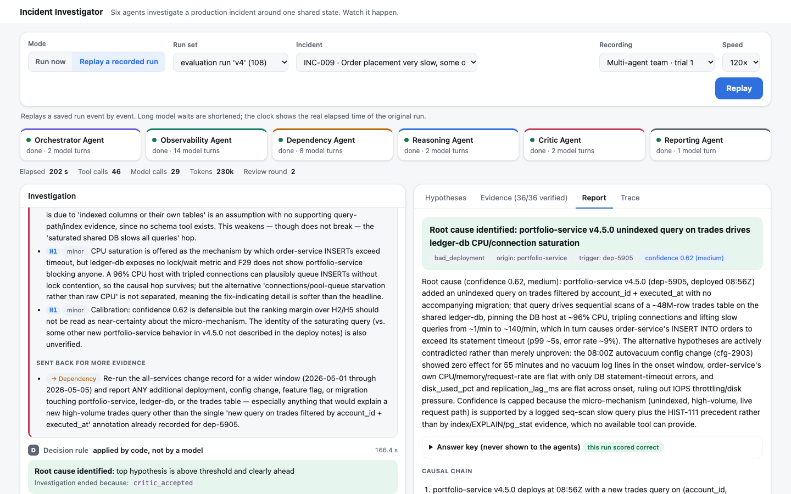

# Incident Investigator

A multi-agent system that investigates production incidents: it gathers evidence through
failure-prone tools, builds and argues over competing root-cause hypotheses, and writes a report that
separates verified facts from assumptions and is allowed to say "inconclusive".

Six agents (Orchestrator, Observability, Dependency, Reasoning, Critic, Reporting) coordinate through
a shared investigation state. A single-agent baseline with the same tools is included, with an
evaluation harness that compares the two on 12 synthetic incidents.

| Deliverable | Where |
|---|---|
| Runnable implementation + setup | this file, `src/rca/` |
| Architecture diagram + coordination | [`docs/ARCHITECTURE.md`](docs/ARCHITECTURE.md) |
| Synthetic incident dataset | `data/` (generated by `dataset/generate.py`), described in [`docs/DATASET.md`](docs/DATASET.md) |
| Automated tests | `tests/` (88 tests, offline, about 7 s) |
| Live web UI | `rca serve`, then http://localhost:8000 (see [Web UI](#web-ui)) |
| Evaluation | [`docs/EVAL.md`](docs/EVAL.md) (method, results, limits); generated tables in [`eval/results/v4/`](eval/results/v4/EVAL_RESULTS.md) (final) and [`eval/results/stress/`](eval/results/stress/EVAL_RESULTS.md); earlier rounds in `main`, `v2`, `v3` |
| Technical note (under 500 words) | [`docs/TECHNICAL_NOTE.md`](docs/TECHNICAL_NOTE.md) |
| Coding-assistant transcript | [`transcript/TRANSCRIPT.md`](transcript/TRANSCRIPT.md) (how it was produced: [`transcript/README.md`](transcript/README.md)) |
| Demo video | [`demo/demo.mp4`](demo/demo.mp4) (terminal walkthrough) and [`demo/ui-demo.mp4`](demo/ui-demo.mp4) (68 s of the web UI), notes in [`demo/README.md`](demo/README.md) |

## Setup

Requires Python 3.11+.

```bash
cd incident-investigator
python -m venv .venv && source .venv/bin/activate      # or: uv venv && source .venv/bin/activate
pip install -e '.[dev]'                                # or: uv pip install -e '.[dev]'

pytest                                                 # 88 tests, no network, no API key
```

To run against a real model, copy `.env.example` to `.env` and set three values. Any
OpenAI-compatible chat-completions endpoint with tool calling works (DeepInfra, OpenRouter, OpenAI,
Azure, Together, a local vLLM or Ollama server):

```bash
LLM_BASE_URL=https://api.deepinfra.com/v1/openai
LLM_API_KEY=...
LLM_MODEL=deepseek-ai/DeepSeek-V4.1-Flash
# optional: a different model per agent role
# LLM_MODEL_CRITIC=...   LLM_MODEL_OBSERVABILITY=...
```

## Run

```bash
rca list                                   # the 12 incidents
rca investigate INC-009 -v                 # multi-agent, streams the investigation trace
rca investigate INC-009 --system single    # single-agent baseline, same tools
rca investigate INC-003 --llm fake -v      # offline: scripted test double, shows the orchestration only

# failure drills
rca investigate INC-007 -v                           # a data source is permanently down
rca investigate INC-001 --chaos 0.3 -v               # 30% extra random transient tool faults
rca investigate INC-001 --agent-fault observability:1 -v   # crash an agent once, watch the retry
```

Each run writes `runs/<incident>-<system>/report.md`, `report.json` and `trace.json` (every event,
tool call, task and critique).

## Web UI

```bash
rca serve                # http://localhost:8000   (rca serve --port 8001 if the port is taken)
```



The page streams an investigation as it happens (Server-Sent Events, standard library only, bound
to 127.0.0.1). The left panel is the investigation: the incident report, the Orchestrator's task
cards filling with tool calls and findings while specialists run in parallel, the Reasoning Agent's
hypotheses, the Critic's review and the tasks it sends back, and the outcome rule. The right panel
has the hypothesis board (confidence per round, with the Critic's cap), the evidence ledger (each
finding with its quote and whether the quote was verified), the final report and the raw trace.
Finding, hypothesis and tool-call ids are links between the two panels.

Two ways to use it:

- **Replay a recorded run.** Any saved run can be replayed, including the real-model runs of the
  evaluation rounds in `eval/results/*/runs/`. Needs no API key. Waiting time is shortened; the
  clock shows the original elapsed time.
- **Run now.** Needs `LLM_API_KEY`. About 2 to 4 minutes for the team, 1 minute for the single
  agent. Options: random tool faults, crash an agent once. Without a key the page opens in replay
  mode.

After a run finishes the report tab can reveal the answer key and the evaluation scorer's verdict
for that run. The agents never see it.

What streams is the event trace (tasks, tool calls, findings, hypotheses, critiques), not model
text token by token: agents answer through structured tool calls, so there is no prose to stream.

## Evaluation commands

```bash
python eval/run_eval.py --name main --trials 3       # both systems, all incidents, scored
python eval/run_eval.py --name abl --systems multi,single,nocritic --trials 3    # adds the no-Critic ablation
python eval/run_eval.py --name stress --trials 2 --chaos 0.3 --chaos-hard 0.1    # random tool faults
python eval/run_eval.py --llm fake --name smoke      # offline check of the harness itself
python dataset/generate.py                           # regenerate the dataset (deterministic)
```

## How it works, in one paragraph

The Orchestrator turns the incident report into a small task graph. Independent tasks run in
parallel on the Observability Agent (logs, metrics) and the Dependency Agent (deployments, config
changes, dependency graph, past incidents); dependent tasks receive the upstream results. Every tool
call goes through an executor that validates arguments, enforces timeouts and budgets, retries
transient failures with backoff, and opens a circuit breaker on a dead data source. Specialists
return findings that cite the tool call they came from with a verbatim quote, and code checks every
quote against the recorded tool output. The Reasoning Agent builds competing hypotheses with a
hop-by-hop causal chain and supporting and contradicting findings. The Critic reviews them and either
accepts, declares the evidence inconclusive, or sends specific evidence requests back, which the
Orchestrator turns into a new round of tasks. The Reporting Agent writes the report; code clamps
confidence to the Critic's cap, demotes any "fact" that is not backed by a verified observation, and
decides the outcome by rule. Details and diagrams: [`docs/ARCHITECTURE.md`](docs/ARCHITECTURE.md).

## Repository layout

```
src/rca/
  models.py            pydantic contracts exchanged between agents
  state.py             shared investigation state (blackboard) + budgets
  grounding.py         mechanical quote verification
  assemble.py          confidence clamps, outcome rule, report rendering (shared with the baseline)
  runner.py, cli.py    entry points
  baseline.py          single-agent baseline
  agents/
    base.py            the agent loop: parallel tool calls, schema-validated submit, repair turns
    prompts.py         all prompts (generic: no dataset entity appears in them; a test enforces it)
    orchestrator.py    planning, task scheduling, feedback loop, termination, recovery
    team.py            Observability, Dependency, Reasoning, Critic, Reporting + automated lint
  tools/
    base.py            tool input schemas, ToolResult / ToolError
    impl.py            the six tools
    faults.py          fault injector (timeout, 503, 429, partial results, seeded chaos)
    executor.py        validation, timeout, retry + backoff, circuit breaker, budget, call ledger
    datastore.py       read-only access to one incident's telemetry
  llm/
    openai_compat.py   any OpenAI-compatible endpoint
    fake.py            deterministic scripted test double
  ui/
    server.py          `rca serve`: runs or replays an investigation and streams its events (SSE)
    index.html         the single-page UI (no build step, no dependencies)
dataset/generate.py    scenario definitions -> data/
data/                  topology, past incidents, 12 incident folders
eval/                  scoring.py (only reader of ground truth), run_eval.py, results/
tests/                 tools, reliability, grounding, orchestration, dataset integrity, scorer, UI server
docs/                  ARCHITECTURE.md, DATASET.md, EVAL.md, TECHNICAL_NOTE.md
```

## Evaluation

12 incidents, 3 trials each, every system on `deepseek-ai/DeepSeek-V4.1-Flash` with the same tools,
fault injection, budgets, evidence rules and scorer. The table is the final round (`v4`). One
outcome rule was tightened afterwards; replayed on the saved traces it changes no `v4` outcome (see
"A run cut short" below). Method, all results, the ablation, the fault stress run and the limits are in
[`docs/EVAL.md`](docs/EVAL.md); generated tables and per-run traces are in
[`eval/results/v4/`](eval/results/v4/EVAL_RESULTS.md) and
[`eval/results/stress/`](eval/results/stress/EVAL_RESULTS.md).

| Metric | Multi-agent | Single-agent baseline | Team without Critic (ablation) |
|---|---|---|---|
| Root-cause accuracy | 89% (32/36) | 94% (34/36) | 86% (31/36) |
| 95% interval | 75%-96% | 82%-98% | 71%-94% |
| Wrong but stated as identified | 0 runs | 2 runs | 1 run |
| Abstained although answerable | 4 runs | 0 runs | 4 runs |
| Correct on the undeterminable incident | 3/3 | 1/3 | 3/3 |
| Cited findings verified against tool output | 99% | 100% | 99% |
| Key-evidence recall | 90% | 94% | 81% |
| Mean confidence in the top hypothesis | 0.68 | 0.84 | 0.55 |
| Tool calls per incident | 44.6 | 23.4 | 23.1 |
| LLM calls per incident | 27.3 | 6.0 | 12.8 |
| Latency per incident, mean | 280 s | 71 s | 128 s |
| Tokens per incident | 224,553 | 84,673 | 81,706 |

**What this shows.**

- *The team does not earn its cost on accuracy.* The intervals overlap, and the single agent is as
  accurate or better at 38% of the tokens and a quarter of the latency.
- *The two systems fail in opposite directions.* All four team misses are abstentions with the
  correct service ranked first. Both single-agent misses are a root cause claimed on INC-007, the
  incident built to be undeterminable, where the team answered "inconclusive" 3 of 3. Two runs do
  not establish this; in the previous round the single agent got INC-007 right 3 of 3.
- *The Critic is most of the cost.* Removing it cuts tokens by 64% and costs three points of
  accuracy (one run), nine points of evidence recall and one wrong claim. The team without a Critic
  costs the same as the single agent and is less accurate, so splitting the work loses something
  that one agent holding the whole context keeps.
- *Random tool faults did not separate the systems.* With 30% of calls failing once and 10% failing
  on every attempt, the team scored 22/24 and the single agent 24/24, neither stated a wrong cause,
  and no run crashed.
- *High stated confidence was reliable.* Across the final round, every answer at 0.75 or above was
  correct for both systems (20/20 and 51/51).

**Earlier rounds**

| Round | Code | Multi-agent | Single agent |
|---|---|---|---|
| [`main`](eval/results/main/EVAL_RESULTS.md) | first version | 94% (34/36) | 100% |
| [`v2`](eval/results/v2/EVAL_RESULTS.md) | after a prompt fix; single-agent runs reused from `main` | 100% (36/36) | 100% |
| [`v3`](eval/results/v3/EVAL_RESULTS.md) | after the first code review | 97% (35/36) | 100% |
| [`v4`](eval/results/v4/EVAL_RESULTS.md) | after the second code review | 89% (32/36) | 94% (34/36) |

Both systems scored lower in `v4`. The code fixes, the provider's behaviour that day and run-to-run
variation all changed together and cannot be separated; the `v3` and `v4` intervals overlap.

**What a reader should know before trusting these numbers.**

1. *The prompts were tuned on these 12 incidents.* There is no held-out split. After `main` I
   changed the Reasoning and Critic prompts to stop one origin being split into two hypotheses.
   I did not tune again after `v4`, where the team abstained on INC-008 in 2 of 3 runs.
2. *One scoring correction.* A single-agent run in `main` named the external exchange by hostname
   and was marked wrong; the hostname was added as an accepted answer and the run re-scored.
3. *Small sample.* 36 runs per system gives intervals about 20 points wide.
4. *The undeterminable incident is not solved reliably by either system.* Besides the single
   agent's two misses above, one extra team run made while recording the demo claimed a root cause
   on INC-007 at 0.55.
5. *The dataset does not separate the systems.* A scripted "blame the latest change" rule scores
   3/12, so the incidents are not trivial, but a strong model solves almost all of them alone.
   Larger topologies and evidence that does not fit one context are where a team should help, and
   that is not tested.
6. *Quote verification has a loophole.* A quote is searched for in the whole tool response,
   including the tool name and call id, so a quote of only those fields verifies (52 of 11,524
   verified quotes in the earlier rounds).
7. *Nothing scores the write-up.* Accuracy is a structured match against the answer key. No judge
   or human rated the summary or the recommended actions.

**Model-sensitivity run: not conclusive.** An earlier comparison on a smaller model
(`openai/gpt-oss-120b`, [`eval/results/weak-model/`](eval/results/weak-model/EVAL_RESULTS.md)) was
dominated by provider timeouts: 23 of 24 team runs stopped on the deadline. Accuracy was 29% against
17%, which mostly measures the provider. It did show that a deadline-cut team run could still claim a
root cause (25% wrong-but-confident).

**A run cut short no longer claims a root cause.** After the final round a third code review led to
one rule change: a team run that stops while the Critic is still asking for evidence, or before any
review finished, now reports "inconclusive" with its ranked suspects. Replayed on the saved traces,
all six wrong-but-confident weak-model team runs become abstentions; the cost is correct answers
that were also unreviewed (five in that round, two in `stress`, none in `v4`). This is tested and
replayed, not re-evaluated with fresh runs. The same review fixed the scorer crediting a failed run
on INC-007 (the weak-model single agent was 25% before the fix) and three smaller defects;
[`docs/EVAL.md`](docs/EVAL.md) lists them.

Total spend on evaluation and demo runs was about 57 million tokens (roughly 13 USD at this
provider's prices).

## What is not finished, and external dependencies

- **LLM provider.** Real runs need an API key for an OpenAI-compatible endpoint that supports tool
  calling. Nothing else is external. Tests and `--llm fake` need no network.
- **Telemetry is simulated.** The tools read generated files. Real adapters (Loki, Prometheus, a
  deploy system) would implement the same six input and output schemas; that work is not done.
- **Scoring is rule-based.** Root-cause accuracy is a structured match on service and category
  against ground truth. A correct diagnosis phrased around an unexpected service name would be
  marked wrong; the per-incident accepted answers are in each `ground_truth.json`.
- **Grounding checks quotes, not meaning.** A verified finding proves the quoted text exists in the
  cited tool output. It does not prove the sentence around it interprets that text correctly. The
  Critic is the only check on interpretation.
- **Small evaluation.** 12 incidents on one simulated platform, three trials each. Differences of
  one or two runs are within noise, as the three runs above show.
- **The web UI is a local demo tool.** One process, in-memory job list, no authentication; it
  listens on 127.0.0.1 only. Runs recorded before the UI existed carry no per-agent start and end
  events, so on replay the Reasoning, Critic and Reporting activity indicators are inferred from
  the order of events.
- **Known defects left in place** (found in review, not fixed because each is a design change rather
  than a bug fix): the circuit breaker is keyed by tool, so a source
  that is down for one service fails fast for every service; follow-up suggestions written by
  specialists are stored but no later prompt reads them.
- **No persistence or resume** of a single investigation: state is in memory and a process crash
  loses the run. The evaluation harness itself is resumable per run.
- **No human-in-the-loop** step.
- **Token cost is not optimised**: no prompt caching, and specialists receive the full findings digest.
