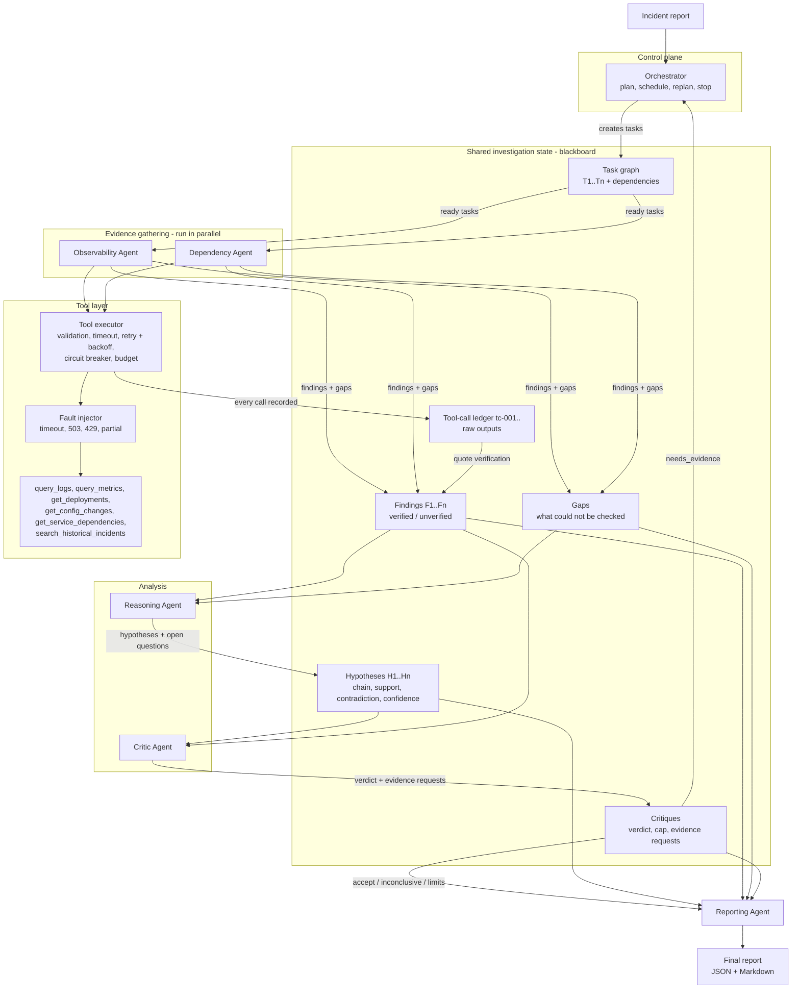
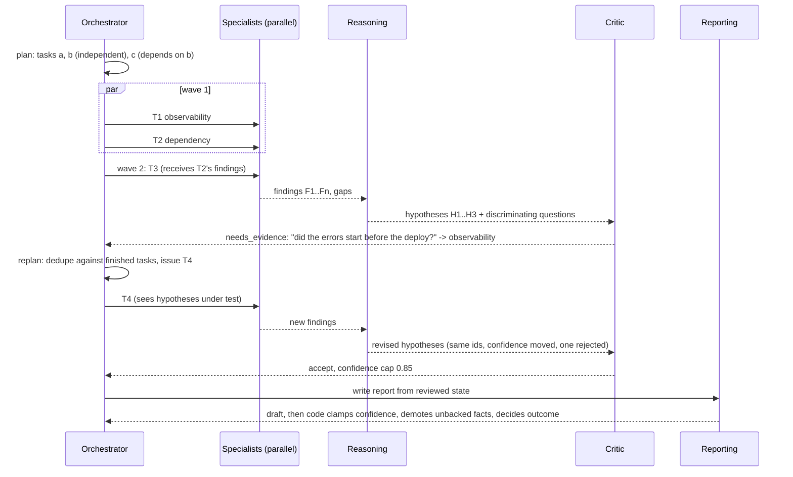

# Architecture and agent coordination

## 1. The shape of the system

Six agents work around one shared investigation state (a blackboard). No agent calls another agent.
Each agent reads the parts of the state it needs, does its job, and writes a schema-validated result
back. The Orchestrator decides who runs next and when the investigation stops.

## 2. Agents and their contracts

| Agent | Tools | Reads | Writes (pydantic model) |
|---|---|---|---|
| Orchestrator | none | incident, critiques, task list, tool health | `Plan` (tasks with `depends_on`), `ReplanDecision` |
| Observability | `query_logs`, `query_metrics` | its task, results of tasks it depends on, findings so far, hypotheses under test | `SpecialistResult` (findings with evidence refs, gaps, answer) |
| Dependency | `get_deployments`, `get_config_changes`, `get_service_dependencies`, `search_historical_incidents` | same as above | `SpecialistResult` |
| Reasoning | none | all findings, gaps, tool health, its previous hypotheses, the last critique | `ReasoningResult` (hypotheses with causal chain, supporting and contradicting finding ids, assumptions, confidence; discriminating questions) |
| Critic | none | hypotheses, findings, gaps, tasks, tool health, automated lint checks | `Critique` (verdict, challenges, evidence requests addressed to a specialist, confidence cap) |
| Reporting | none | the reviewed ranking, findings, gaps, critiques | `ReportDraft` (facts, assumptions, timeline, actions, data gaps) |

All ids (`F3`, `H2`, `T4`, `tc-017`) are assigned by code. A reference to an id that does not exist is
removed and recorded as an integrity warning, so one agent cannot cite something another agent never
produced.

## 3. One investigation, step by step

## 4. Why this is collaboration and not a chain of prompts

1. **Work is routed by content, not by position.** The Critic's evidence requests name a specialist
   and a question. The Orchestrator turns them into tasks, drops ones a finished task already
   answered, and the specialist that runs the task sees the hypotheses it is being asked to test.
2. **Agents build on each other's structured output.** A task with `depends_on` receives the findings
   of the upstream task (for example the dependency map decides which neighbours the Observability
   Agent checks). The Reasoning Agent can only cite finding ids that specialists produced.
3. **Beliefs are revised, not regenerated.** Hypotheses keep their ids across rounds. Each keeps a
   per-round confidence history, and the Reasoning Agent must move confidence down or reject when a
   critique or new finding warrants it.
4. **One agent can overrule another.** The Critic's confidence cap is applied by code to the
   Reasoning Agent's numbers. The Reporting Agent cannot re-rank and cannot raise confidence. If the
   reporter writes "root cause identified" while the rule says inconclusive, the rule wins and the
   override is logged.
5. **Code and models check each other.** Deterministic lint (unverified support, causal hops with no
   evidence, high confidence with live competitors, failed tasks) is given to the Critic as input, so
   its review starts from mechanical facts.

## 5. Evidence model: facts versus assumptions

- Every tool call is stored in an append-only ledger with the exact bytes the model saw.
- A finding must cite `call_id`s and a short verbatim quote from that output. `grounding.py` checks
  the quote against the ledger after normalising case and punctuation. No model is involved.
- `verified` + `kind="observation"` is a **fact**. Everything else (inferences, unverified findings,
  the reporter's suspicion, past incidents) is an **assumption** and is labelled as such in the report.
- A causal chain is a list of hops. A hop with no finding id is shown as *(assumed)*.
- Confidence rules applied by code: the Critic's cap; a 0.3 ceiling for a hypothesis with no verified
  supporting finding.
- Outcome rule applied by code: **inconclusive** if no hypothesis is active, the top confidence is
  below 0.5, the Critic's final verdict is inconclusive, two different explanations are within 0.1
  of each other above the threshold, or the run stopped while the Critic was still asking for
  evidence or before it reviewed the current hypotheses. A Critic outage and the no-Critic ablation
  are the two unreviewed cases that may still conclude, capped at 0.6 and flagged.

## 6. Orchestration and reliability

| Requirement | Mechanism | Where |
|---|---|---|
| Parallel execution | Ready tasks of a wave run under `asyncio.gather` (semaphore-bounded). Tool calls issued in one model turn also run concurrently. | `orchestrator.run_pending`, `agents/base.py` |
| Shared state | `InvestigationState`: findings, gaps, hypotheses, critiques, tasks, usage, event trace | `state.py` |
| Task dependencies | `Task.depends_on`; a task is ready when its dependencies are settled; dependencies may only point backwards, so the graph is acyclic by construction; an unknown or forward key is ignored with a warning | `orchestrator._register` |
| Feedback loop | Critic `needs_evidence` -> Orchestrator replan -> new specialist tasks -> Reasoning revises -> Critic re-reviews | `orchestrator.investigate` |
| Bounded retries | Tools: up to 2 retries with exponential backoff, only for retryable errors. Structured output: up to 2 repair turns. Specialist task: 2 attempts. Reasoning, Critic, Reporting: 1 retry. | `tools/executor.py`, `agents/base.py` |
| Execution limits | 60 tool calls (8 per specialist task), 40 LLM calls, 400k tokens, 420 s wall clock, 3 review rounds, 3 tasks per round, 6 turns per specialist | `config.Budget` |
| Termination | See table below | `orchestrator.investigate` |

**Termination conditions**

| Reason | Trigger |
|---|---|
| `critic_accepted` | Critic verdict `accept` |
| `critic_inconclusive` | Critic says the data cannot separate the hypotheses and asks for nothing more |
| `max_rounds_reached` | Third review still asks for evidence (outcome: inconclusive) |
| `no_new_evidence_paths` | Every requested task duplicates one already run, or the Orchestrator chooses to finalize |
| stall | A feedback round adds no verified finding: one last review, then stop |
| `budget_exhausted:*` | Tool-call, LLM-call, token or wall-clock limit. Limits are checked between model calls, so one slow call can overshoot the wall clock; the Reporting Agent is exempt so a report is always written |
| `reasoning_agent_failed`, `critic_failed_unreviewed` | Agent still failing after its retry |

**Failure handling**

| Failure | Detection | Recovery |
|---|---|---|
| Tool timeout, 503, 429 | Typed error, `retryable=true` | Retry with backoff; if still failing, the structured error goes to the agent |
| Tool returns incomplete data | `partial=true` plus a warning | Not hidden by a silent retry. The agent re-queries or records a gap; prompts say absence in a partial result proves nothing |
| Data source permanently down | Three consecutive hard failures | Circuit opens; later calls fail fast; a gap is recorded; the Critic may return `inconclusive` |
| Bad tool arguments | Pydantic validation | `invalid_arguments` with the message and valid alternatives; does not count against the breaker |
| Bug inside a tool | Any exception | Contained as an `internal` error |
| Model returns prose or invalid JSON | No tool call, or schema validation fails | Validation error is sent back; bounded repair turns |
| Specialist crashes | Exception from the agent loop | Task retried once, then marked failed with a gap; the rest of the investigation continues |
| Planner fails | `AgentError` | Generic default plan (code) |
| Replanner fails | `AgentError` | Critic's requests converted to tasks mechanically |
| Critic fails | `AgentError` after retry | Analysis marked unreviewed, confidence capped at 0.6 |
| Reporter fails | `AgentError` after retry | Minimal report assembled by code |

Every one of these paths has a test in `tests/test_reliability.py` or `tests/test_orchestration.py`.

## 7. The single-agent baseline

`baseline.py` runs one ReAct loop with all six tools through the same executor (same fault
injection, retries and tool-call budget), the same evidence rules in its prompt, the same quote
verification, the same confidence ceiling and outcome rule, and the same scorer. The only differences
are the ones being measured: no task decomposition, no parallel specialists, no separate reasoning
step, no critic and no feedback loop.

## 8. Design influences

- [OpenRCA](https://mlanthology.org/iclr/2025/xu2025iclr-openrca) and a
  [follow-up failure analysis](https://cloudintelligenceworkshop.org/papers/aiops26-Kim.pdf) report
  that the commonest agent failures in RCA are hallucinated readings of data and incomplete
  exploration. That motivated mechanical quote verification and a Critic whose checklist is about
  coverage (all services' changes, more than one metric, wider windows).
- [OpenRCA 2.0](https://tldr.takara.ai/p/2606.27154) names "ungrounded diagnosis": the right service
  with no verified propagation path. That motivated the per-hop causal chain and the
  `causal_chain_grounded` metric.
- [Anthropic's multi-agent research system write-up](https://www.anthropic.com/engineering/multi-agent-research-system)
  reports multi-agent runs using several times the tokens of a single agent. The evaluation therefore
  reports tokens, tool calls and latency next to accuracy.
- [mABC](https://www.arxiv.org/abs/2404.12135) notes that a single final judge is a weak point when
  faults propagate across services, which is one reason the Critic can send work back instead of only
  scoring.
